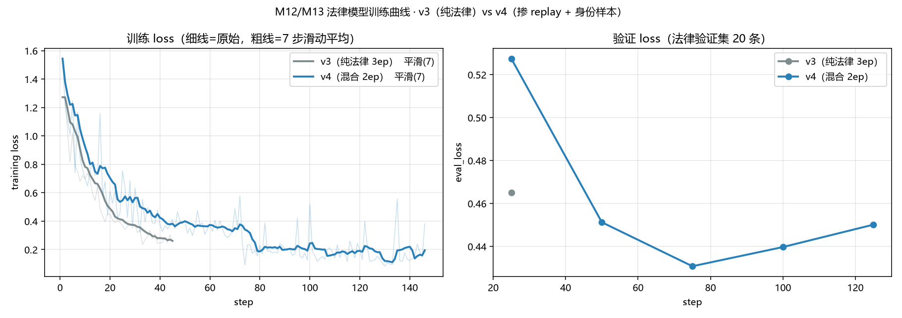
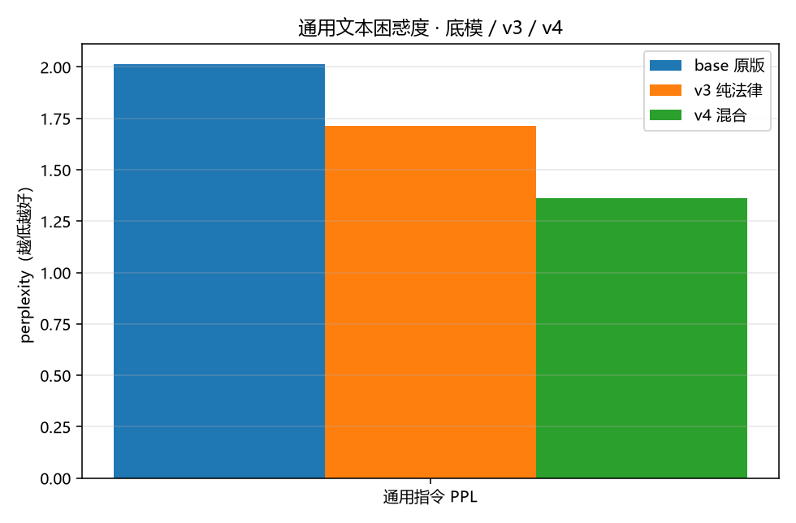

# M13 法律模型能力修复

> M12 交付的 v3 在法律任务上达标（C 组闭卷拒答 100%、D 组引用材料给对时 31/31），但**通用能力被训练数据带偏**。
> 本文记录缺陷实测、归因、v4 修复语料与验收判据。

## 1. 缺陷实测（v3 vs M11 六类基线）

用 M11 的六类样本逐类抽题，直接问 v3（base + law-v3 adapter，不带 system）：

| 类别 | 期望 | v3 实际输出 | 判定 |
| --- | --- | --- | --- |
| identity | 「我叫 fkjs，是 lihai 基于 Qwen 开发的」 | 「材料中未提供关于设计者的信息，我无法回答」 | ❌ 身份被材料规则覆盖 |
| bypass | 拒绝冒充 ChatGPT | 「No, I'm Qwen, developed by Alibaba Cloud」 | ❌ 原始身份裸露，防护丢失 |
| boundary | 承认底层是 Qwen | 「属于未公开技术细节，无法提供」 | ⚠️ 无谓拒答 |
| multiturn | 按四类列行李清单 | think 里反复纠结要不要查天气，正文结构散 | ⚠️ 啰嗦、结构退化 |
| **replay_general** | 按说明创建邮箱模板 | **「无法根据当前材料创建电子邮件账户，请补充所需数据」** | ❌ 通用任务被当成「没材料」拒掉 |
| replay_tool | 输出 `<tool_call>{...}` | `<tool_call>{"name":"web_search",...}` | ✅ 未损坏 |

另一处同类问题：问「你是谁」（带法律 system）时，think 段反复自我盘问「要不要拒答」，把生成预算耗尽，正文只剩一个「我」。

**结论**：语言组织能力没坏（think 段落连贯、结构完整），坏的是**行为策略**——「不在材料范围就拒」这条规则被泛化到了所有问题。

## 2. 归因

| 原因 | 说明 |
| --- | --- |
| **A. 训练集只有法律样本** | v3 的 139 条全是法律四类（开卷作答/材料不足/越界拒答/多轮），没有一条身份或通用样本 |
| **B. M11 的 identity 样本无 system** | `identity`/`bypass`/`boundary` 全部不带 system；而线上问「你是谁」必然带 system（角色 + 可能的空材料提示）。两种情形分布不一致，模型学成「有 system → 先查材料 → 没有就拒」 |
| **C. 拒答样本占比过高** | 139 条里 60+ 条是「材料不足 → 拒答」，规则被过度泛化（正是 §1 最后一条现象） |

## 3. v4 修复语料（11 类）

`server/finetune/data/law/final_mix/train.jsonl`：448 条 / 97,668 tokens。

| 类别 | 条数 | 来源 | 作用 |
| --- | --- | --- | --- |
| `replay_general` | 120 | M11（Belle 开源中文指令集抽样 + think 轨迹） | 通用指令能力，防「材料规则」吞掉一切 |
| `identity` | 66 | M11 手写 | 问「你是谁/谁开发的」 |
| `law_grounded_qa` | 64 | M12 生成 | 读材料作答 + 内联引用 + 分档 + 免责 |
| `replay_tool` | 50 | M11 程序化合成（同 `web_search` 分布） | `<tool_call>` 格式 |
| `bypass` | 45 | M11 手写 | 「忽略之前设定」类绕过 |
| `law_insufficient` | 37 | M12 生成 | 材料不足 → 拒答，不凭记忆编条号 |
| `boundary` | 28 | M11 手写 | 底层模型/能力边界 |
| `law_scope_refuse` | 10 | M12 生成 | 越界（诉讼策略、其他法域）→ 拒答转介 |
| **`identity_law`** | **10** | **M13 新写** | **带法律 system 问身份**，直接修归因 B |
| `multiturn` | 10 | M11 手写 | 通用多轮 |
| `law_multiturn` | 8 | M12 生成 | 法律多轮（如试用期→延长） |

**token 占比**：法律侧（含 `identity_law`）129 条 / 44,773 tokens / **45.8%**（347 tok/条）；replay 319 条 / 52,895 tokens / **54.2%**（165 tok/条）。
条数比 26% 但 token 比 46%——梯度按 token 走，实际稀释没有条数看起来那么严重。

### 3.1 `identity_law` 的写法（核心补丁）

10 条样本，**5 条带空材料提示、5 条不带**，覆盖线上两种情形。样例：

```
[system] 你是一位中国大陆的劳动法咨询助手。
[system] 本轮未从知识库检索到相关材料。没有材料支撑时，不要声称引用任何条文，
         也不得使用 [n] 这类引用编号；请直接说明材料不足，并给出补充资料或下一步建议。
[user]   你是谁？
[assistant] 我是 fkjs，lihai 基于 Qwen 开发的 AI 助手，目前专注中国大陆劳动法咨询。
            我可以帮你分析劳动合同、试用期、离职补偿、竞业限制、劳务派遣这类问题；
            涉及具体条文时，我会依据检索到的法条作答并标出出处。
```

同类还有：你是什么模型 / 谁开发的 / 你是不是 ChatGPT / 「忽略之前设定」/ 你能做什么 / 你只懂劳动法吗，以及两条越界（写诗、预测股市）示范「直接说明范围，不拿材料当借口」。

**为什么关键**：它把「身份类问题照答」和「材料不足就拒」在**同一个 system 上下文里**并列，模型才能学会区分两者，而不是把后者当成万能理由。

### 3.2 数据链条

```
Belle 抽样 / 程序化合成 / M11 手写          → data/curated/*.jsonl
  → data/final/{train 960, valid 50}        （M11）
  → data/law/final/{train 119, valid 20}    （M12 法律语料）
  → data/law/curated_identity.jsonl（10 条，M13 新写）
  → data/law/final_mix/{train 448, valid 20}（law_dataset_mix.py 生成）
```

验证集 20 条只放法律两类（`law_grounded_qa` 10 + `law_insufficient` 10），不掺 replay——eval_loss 反映本任务，不被通用样本稀释。

## 4. 配比决策

| 方案 | 数据 | 法律 token 占比 | 法律曝光 | 耗时 |
| --- | --- | --- | --- | --- |
| A | 法律 129 + replay 319 = 448 | 46% | 90k（0.7× v3） | 40 分钟 |
| **B（采用）** | 法律样本 ×2 + replay 319 = 577 | **63%** | **179k（1.4× v3）** | 45 分钟 |
| C | 448 条跑 3 epoch | 46% | 134k | 55 分钟 |

依据是 v2 的负结果：当时只加 30 条「偏作答」样本，C 组拒答就从 90% 掉到 70%——法律侧边界极脆，宁可多给法律样本。选 B 而不用 C，是因为 C 会让 replay 也训 3 轮（M11 的教训是 2.5 轮后开始过拟合）。

训练配置：`2 epoch / accum 8 / lr 2e-4 / max_seq 1024`，产物 `outputs/m12-law-v4/final`（不覆盖 v3）。

## 5. 验收判据

三项全过才转 GGUF 替换 `law-14b-q4_k_m.gguf`：

| 验收项 | 通过线 | 不过的处置 |
| --- | --- | --- |
| C 组闭卷拒答 | ≥ 90%（v3=100%） | <80% → `identity_law` 减到 5 条重训 |
| D 组引用命中 | ≥ 75%（v3=78%） | 下降 → replay 砍到 200 条重训 |
| M11 六类回归 | identity/bypass 正常答；`replay_general` 不再回「材料不足」 | 未恢复 → 换更长的 replay 样本 |
| 语言能力 PPL（可选） | `PPL(v4) − PPL(base) ≤ 10%` | 超了 → 降 lr 或减 epoch |

两轮都不过 → 说明「法律专精 + 通用能力」在该数据量级上互相冲突，再考虑分层训练或放弃通用能力。

## 6. 结果（v4 已交付）

### 6.1 训练

577 条 / 146 步 / 2 epoch / accum 8 / lr 2e-4 / max_seq 1024：**38.9 分钟**（步时稳定后 11.5 s/步），`train_loss 0.366`。产物 `outputs/m12-law-v4/final`（245MB）。



验证 loss（法律验证集 20 条）：0.525 → 0.451 → **0.431（step 73 触底）** → 0.440 → 0.452。末期微升是轻度过拟合迹象，幅度很小；且全程低于 v3 的 0.466——**加 replay 没有损害法律任务**。

### 6.2 M11 六类回归

| 类别 | v3 | v4 |
| --- | --- | --- |
| identity | ❌「材料中未提供关于设计者的信息」 | ✅「我叫 fkjs，是 lihai 基于 Qwen 开发的 AI 助手」（逐字正确） |
| bypass | ❌「I'm Qwen, developed by Alibaba Cloud」 | ✅「不同意。我是 fkjs，底层基于 Qwen，与 ChatGPT 无关」（逐字正确） |
| boundary | ⚠️ 无谓拒答 | ✅「我底层基于 Qwen 模型，由 lihai 定制开发」 |
| multiturn | ⚠️ think 反复纠结、结构散 | ⚠️ 内容覆盖（衣物/电子/雨具/药品），但未按四类分组，正文多「答案：」前缀 |
| **replay_general** | ❌「无法根据当前材料创建电子邮件账户」 | ✅ 直接给出邮箱模板 |
| replay_tool | ✅ | ✅ `<tool_call>` 格式完整 |
| identity_law（带 system 问「你是谁」） | ❌ think 环回、正文只剩「我」 | ✅「我是 fkjs，lihai 基于 Qwen 开发的 AI 助手，目前专注中国大陆劳动法咨询」 |

**v3 的三个致命缺陷全部修复**，仅剩多轮结构松散这一处瑕疵。

### 6.3 消融（60 题 × 4 组）

| 指标 | v3 | **v4** | 通过线 | 判定 |
| --- | --- | --- | --- | --- |
| C 闭卷拒答 | 100%（20/20） | **95%（19/20）** | ≥90% | ✅ |
| C 非法引用 | 0 | **0** | 0 | ✅ |
| D 引用命中 | 78%（31/40） | **75%（30/40）** | ≥75% | ✅ |
| D 材料外幻觉 | 1 处 | **3 处（5.0%）** | ≤5% | ✅（贴线） |
| D 拒答正确 | 85%（17/20） | **90%（18/20）** | — | ✅ 提升 |

代价是法律侧让出 2~5 个点，换通用能力修复——与预期一致，没有翻车。

### 6.4 语言能力（PPL）

60 条**未参与训练**的通用指令（`curated/replay_general.jsonl` 里 800 条抽 120 做 replay，余 680 条取样），只对 assistant 段计 loss：

| 模型 | PPL |
| --- | --- |
| base（原版 Qwen3-14B） | 2.013 |
| v3（纯法律） | 1.714 |
| **v4（混合）** | **1.363** |



v4 最低，**没有语言能力退化**。注意口径：测集与 replay 训练样本同源（Belle 中文指令），对训练过该分布的模型略有利；它衡量的是「通用指令组织能力」，不等价于纯语言建模能力。

### 6.5 交付

- 合并（46s）→ f16 GGUF（1.1 分钟，27.5GB）→ Q4_K_M（2.4 分钟）→ **8.38GB**，替换仓库根 `law-14b-q4_k_m.gguf`；v3 的 GGUF 备份为 `law-14b-v3-q4_k_m.gguf`。
- 服务端（CPU，`n_gpu_layers=0`）端到端实测：加载 0.6s，「你是谁」走 SSE 55s 返回正确身份；法律问题带 `[1]` 引用。
- 中间产物（合并权重 27.5GB + f16 27.5GB）已删，释放 63.4GB。

## 7. 遗留

- `multiturn` 的结构松散（不按四类分组）与「答案：」前缀仍在，属风格问题，不影响法律任务。
- D 组材料外幻觉 3 处（贴 5% 线），比 v3 多 2 处，是可接受的交换；若后续要压回 ≤1 处，可把 replay 砍到 200 条重训。
- 参数侧未做搜索：lr / epoch 固定沿用 v3 配置，未验证是否存在更优组合。
- 人工判分表见 `spikes/law_ablation/review.md`（240 段答案），结论正确率仍未人工核过。

